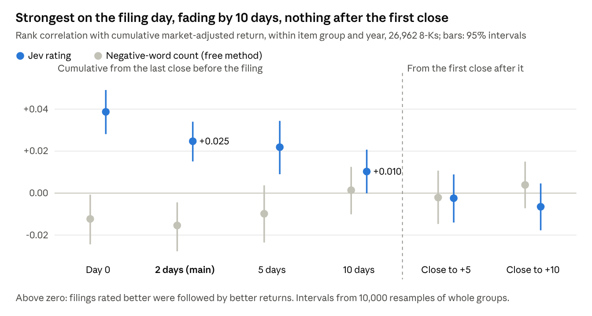
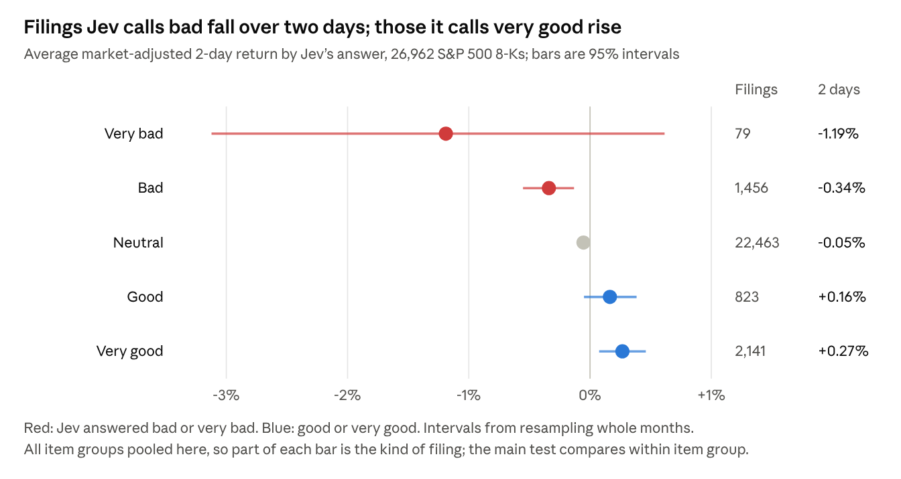

# Language-model ratings of 8-K filings and short-term stock returns

October 2026 · [magilliam27](https://github.com/magilliam27)

## Summary

A multiple-choice language model (Jev, from TypeSafe) rated 26,962 8-K filings by S&P 500 companies, filed between January 2013 and October 2026, on a five-point scale from very bad to very good for shareholders. Within filings of the same type and year, lower ratings were followed by lower market-adjusted returns over the next two trading days. The rank correlation is +0.025 (95% interval +0.015 to +0.034) and is positive in 13 of 14 years. A negative-word count scores −0.015 on the same test, a difference of +0.040 (+0.026 to +0.055).

The effect is small and concentrated on the first trading day. No further return is predicted after the first close following the filing. The main unresolved risk is that the model may have seen later reporting on these events. Rating all filings cost $2.32.

Earlier work on 10-K risk factors, which found no return signal, is summarised in Appendix C.

> Research only, not investment advice. The result has not been tested out of sample (see Limitations).

## 1. Question and approach

The aim is a filing-based signal that can be used on its own or as an input to [MCI-GRU](https://github.com/magilliam27/MCI-GRU), a stock-ranking model.

Jev (jev-1.13.0, from [TypeSafe](https://docs.typesafe.ai)) answers multiple-choice questions and returns a probability for each option, so each answer converts to a score that can be ranked. The model cannot be fine-tuned, so all design work went into the wording of the question.

**Research question.** When a company files an 8-K reporting an event such as an officer departure, a deal or a restructuring, do lower ratings precede lower returns?

**Reading check.** Before the returns test, Jev rated 436 8-Ks from 10 large companies (E10), and its ratings were compared with a key built by three blind AI reviewers. Jev ranked the bad events with an AUC of 0.986, against 0.759 for the item code plus a word count.

**Baselines.** Each result is compared with two simple, free methods: a negative-word count and the filing's item code. Definitions of all terms are in Appendix A.

## 2. Method

| Step | Detail |
| --- | --- |
| Filings | Every 8-K from January 2013 to October 2026 by an S&P 500 member reporting one of ten event items (officer change, agreement, deal completed, restructuring, impairment, delisting notice, auditor change, restatement, agreement ended, bankruptcy): 28,253. |
| Exclusions | Set before any score existed: 848 filings that also reported earnings, 253 same-day duplicates, and 190 without prices or a full 10-day window. 26,962 remain. |
| Model input | The filing text plus facts known on the filing date: item codes, prior-year revenue and the company's 8-Ks from the previous 90 days. One question with a fixed rubric. |
| Return | From the last close before the SEC accepted the filing, minus the SPY return, so no price move before publication is counted. |
| Comparison | Within the same item group (officer change, deal, negative-leaning, auditor change) and year, 44 groups in all, so the item type alone cannot explain the result. |
| Intervals | 10,000 bootstrap resamples of those groups. |

## 3. Results

**Example.** On 12 December 2016, before the open, Alexion Pharmaceuticals reported the immediate resignation of its CEO "for personal reasons" and the departure of its CFO. Jev rated the filing very bad (98% probability of bad or very bad). Alexion closed the next day 17.3% below the market. Planned retirements with a named successor share the same item code, are usually rated neutral, and show little price movement.

The association is strongest on the filing day and fades by day 10. Measured from the first close after the filing, neither method predicts returns.

Positive ratings show a smaller effect: only "very good" is clearly above zero. 83% of filings are rated neutral, and their returns are close to zero.

**Returns by item group and rating.** Every cell with at least 20 filings, including cells that run against the overall result. Average market-adjusted return with 95% intervals from 2,000 resamples of whole calendar months.

| Item group | Jev's answer | Filings | 2 days | 10 days |
| --- | --- | --- | --- | --- |
| Officer change | very bad | 25 | −2.16% (−4.26 to −0.17) | −2.45% (−5.61 to +0.40) |
| Officer change | bad | 774 | −0.68% (−1.02 to −0.37) | −0.89% (−1.40 to −0.36) |
| Officer change | neutral | 15,348 | −0.06% (−0.11 to −0.00) | −0.13% (−0.27 to +0.01) |
| Officer change | good | 53 | +0.27% (−0.42 to +0.98) | −0.64% (−2.24 to +0.81) |
| Officer change | very good | 63 | +0.14% (−0.56 to +0.82) | −0.11% (−1.56 to +1.11) |
| Deal | bad | 178 | +0.42% (−0.29 to +1.38) | +0.23% (−1.11 to +1.93) |
| Deal | neutral | 6,112 | −0.06% (−0.13 to +0.01) | −0.13% (−0.35 to +0.10) |
| Deal | good | 714 | +0.14% (−0.09 to +0.37) | +0.07% (−0.45 to +0.60) |
| Deal | very good | 1,941 | +0.32% (+0.12 to +0.53) | +0.11% (−0.24 to +0.46) |
| Negative-leaning | very bad | 44 | −0.87% (−2.81 to +0.75) | −0.98% (−4.06 to +2.01) |
| Negative-leaning | bad | 501 | −0.07% (−0.34 to +0.20) | +0.22% (−0.33 to +0.81) |
| Negative-leaning | neutral | 942 | −0.02% (−0.22 to +0.17) | −0.23% (−0.62 to +0.16) |
| Negative-leaning | good | 56 | +0.40% (−0.49 to +1.26) | +1.70% (+0.04 to +3.58) |
| Negative-leaning | very good | 135 | −0.49% (−1.48 to +0.18) | −0.35% (−1.56 to +0.62) |
| Auditor change | neutral | 61 | +0.29% (−0.35 to +0.98) | +0.99% (−0.34 to +2.52) |

Separation is clearest for officer changes. For deals and negative-leaning items, the bad and very good cells are mixed. The item code alone has no predictive value (−0.005, interval −0.017 to +0.006). Per-item results and day-by-day paths are in [`summary.json`](experiments/E11-8k-returns/grading/summary.json).

**Economic size.** Within each item group, the top fifth of filings by rating outperformed the bottom fifth by 0.29 percentage points over two days (+0.16 to +0.42), before trading costs. Because the move is complete by the first close, this measures explanatory power rather than an achievable trading return.

## 4. Limitations

The result is consistent across filings and years, but it is small and short-lived, and it rests on an assumption that could not be tested: that the model had no knowledge of how these events unfolded.

| Limitation | Detail |
| --- | --- |
| Model memory (principal risk) | Jev may have been trained on later reporting about these events. TypeSafe does not publish a training cut-off, so the planned out-of-sample check could not be run. The 107 filings dated after Jev's release on 10 September 2026 show the same direction (+0.034) but are too few to be conclusive. |
| Small per filing | The rating explains well under 1% of the variation in 2-day returns. It is a tilt across many filings, not a forecast for any one. |
| Timing | The move occurs on the first trading day, and nothing follows the first close. Entry at the next open after an evening filing was not tested, and trading costs were not measured. |
| Prior announcements | Many companies issue a press release before the 8-K, so the window can miss the first reaction. Filings with a press release attached, more likely to be the first announcement, show a stronger association: +0.042 against +0.027. |
| Baseline not combined | Jev was compared with the word count directly. Its value in addition to the word count was not tested. |
| AI answer key (E10) | The reading check was graded against three blind AI reviewers who used the same rubric as Jev, so it shows consistent reading rather than value. The returns test needs no key. |
| Scope | S&P 500 members only. Returns are adjusted for the market only, with no industry, size or value controls. Prices are EODHD adjusted closes, with no delisting payouts. |

## 5. Costs

Rating the 26,962 filings cost $2.32 of Jev time (55 million input tokens at $0.042 per million), about 9 cents per 1,000 filings.

| Item | Cost |
| --- | --- |
| Jev, returns test (E11) | $2.32 for 26,962 filings |
| Jev, reading check (E10) | About $0.07 for 436 filings |
| Ongoing rating | About 1,950 qualifying 8-Ks a year, or about 18 cents a year |
| SEC filings | Free (37,860 download requests) |
| Prices (EODHD) | Paid monthly plan; E11 reused an earlier download of about 1,420 calls. The subscription price is not recorded. |
| AI sessions and reviewers | Not metered |

## 6. Controls against bias

| Control | Detail |
| --- | --- |
| Pre-registration | Each experiment's design (data, question, baseline, measure and pass rule) was fixed before any labels, model answers or prices existed. Any change to the question, data or key required a new experiment id. For E11 the design was frozen on 16 October at 12:45 UTC, the filings published at 14:24, the ratings produced at 03:17 the next day, and returns computed only after that. |
| Separation of roles | Four separate AI sessions handled data, model questions, blind reviewing and grading. The session querying Jev never saw keys or returns, the reviewers never saw Jev's answers, and keys and prices were opened only at grading. |
| File fingerprints | The SHA-256 hash of every frozen file is recorded at the time of freezing, so graded files can be matched to frozen ones. |
| Baseline comparison | Every test compares Jev with a free method, and a pass requires the 95% interval of the difference to exclude zero. |
| Recomputation | Every verdict number was recomputed by script, at least one case was traced by hand, and E11 was replicated independently. |
| Null results reported | Stopped and failed experiments remain in the record with their numbers (Appendix C). Each experiment's frozen design and result is in [`experiments/`](experiments/). |

## 7. Independent replication

A separate AI session received the frozen design and the raw data, but not the grading code, and rebuilt E11 from scratch. It reproduced every headline number.

| Figure | Reported | Recomputed |
| --- | --- | --- |
| Events (officer, deals, negative, auditor) | 26,962 (16,263, 8,953, 1,678, 68) | identical |
| Jev, 2-day correlation | +0.025 (+0.015 to +0.034) | +0.0247 (+0.0151 to +0.0340) |
| Jev minus word count, 2-day | +0.040 (+0.026 to +0.055) | +0.0401 (+0.0260 to +0.0545) |
| Jev, 10-day correlation | +0.010 (−0.000 to +0.021) | +0.0103 (−0.0001 to +0.0207) |
| Officer changes Jev calls bad, mean 2-day return | −0.684% | −0.684% |

Further checks:

| Check | Result |
| --- | --- |
| Returns | All 1-, 2- and 10-day returns match event by event. Three were traced by hand: Stericycle (very bad, −15.7% against the market), Andeavor (very good, +2.9%) and Tapestry (neutral, +0.7%). |
| Permutation test | Shuffling the ratings within groups 200 times gives correlations centred near zero. The observed +0.025 exceeds every shuffle. |
| Look-ahead | In 26,961 of 26,962 filings the starting price precedes publication. The exception was accepted at exactly 16:00:00, the moment of the close. |
| Ticker matching | For 166 filings with an ambiguous ticker (FOX/FOXA, GOOG/GOOGL and similar), the replication used the original symbol, which was always one of its own two candidates. |
| Error found | The 10-day column of the item-group table covered one extra trading day. It has been corrected; no correlation or verdict changed. 30 stocks that stopped trading right after a filing now earn the market return, as designed. |
| Minor notes | About 21 filings fell on half-day sessions, with no look-ahead. Auditor changes (68 filings) run the other way (−0.09) but carry 0.3% of the weight. |

## Appendix A. Definitions

| Term | Meaning |
| --- | --- |
| 10-K | The annual report. Its "risk factors" section lists what could harm the business. |
| 8-K | A report of a single event, filed within four business days. The item code gives the type (5.02 is an officer change, 1.01 a material agreement). |
| Market-adjusted return | The stock's return minus the return of SPY, an S&P 500 index fund, over the same days. |
| Rank correlation (Spearman) | Agreement between two orderings, from −1 to +1; zero means no relation. |
| AUC | The probability that a true case is ranked above a randomly chosen other case; 0.5 is chance, 1.0 perfect. |
| 95% interval | The range likely to contain the true value, computed by bootstrap: the data are resampled with replacement thousands of times and the middle 95% of the recomputed values is kept. A test passes only if the interval excludes zero. |
| Word count | The count of negative words from the Loughran-McDonald finance word list. |
| E1 to E11 | Experiment ids, in order of design. |

## Appendix B. Reproduction

The original research folder held the bulk data (filings, prices) and Jev's stored answers. In that folder, E11 and E10 reproduce their published `summary.json` byte for byte with no new model calls, and the independent replication matched every headline number.

This repository publishes the code, the frozen questions, the experiment records and the summary results. It does not include:

| Not included | Reason | How to obtain it |
|---|---|---|
| SEC filings | Large, and free to download | `scripts/data/build_sp500_members.py` and `scripts/data/export_sec_member_8k.py` rebuild the 28,253-filing set from EDGAR |
| Daily prices | Paid EODHD data | An EODHD subscription and `scripts/data/export_eodhd_pit_prices.py` |
| Jev's per-filing ratings | Withheld pending a check of the model provider's terms | Re-ask Jev with `scripts/data/score_8k_events.py` (about $2.32 for all filings) |
| Loughran-McDonald word list | Free for academic use only | Download from the Software Repository for Accounting and Finance at the University of Notre Dame |

Repeated Jev calls give slightly different probabilities, so re-asked ratings will be close to the originals but not identical. With those inputs in place, `grading/VERIFY.md` documents every grading script and command. The replication code is `grading/independent_recheck/independent_recheck_code.py`. Software used: Python 3.13, pandas 3.0, numpy 2.5.

SHA-256 fingerprints of the E11 inputs, recorded when each was frozen:

| File | Frozen | SHA-256 starts … ends |
| --- | --- | --- |
| 8-K events, `member_8k_events.jsonl` | 16 Oct 14:24 UTC | 04172c9b … 931f |
| Test-set ids, `events.csv` | 16 Oct 14:26 UTC | f885c806 … 0b3b |
| Word-count baseline, `baselines.csv` | 16 Oct 14:29 UTC, before any Jev call | 9a6296a9 … 1bdda |
| Jev's ratings, `scores.csv` | 17 Oct 03:17 UTC, before any return | eb56f1c8 … d05b |
| Jev's raw answers, `rating.jsonl` | 17 Oct 03:17 UTC | 8b3456b9 … 3bfc |

`events.csv` and `baselines.csv` are in `results/E11-8k-returns/` and can be checked against these fingerprints.

**Corrections.** The 10-day column of the E11 item-group table was corrected after the replication; the original output is kept as `results/E11-8k-returns/summary_v1.json`.

## Appendix C. Other avenues explored

Before the 8-K study, the program examined 10-K risk factors, the annual list of what could harm a business. Each step followed from the result of the one before.

| Step | Question | Result |
| --- | --- | --- |
| 1 | Can Jev detect that a 10-K risk changed from the prior year? | No better than a word count across five tests on 11 companies (E1 to E6). Stopped. |
| 2 | Can Jev judge whether a change made a risk worse or better? | Yes, on two separate sets of 10 companies (E8, E9). Word counts cannot judge direction. |
| 3 | Do 10-K risk changes predict 1 to 6 month returns? | No, for either Jev or word counts (E7, 6,871 S&P 500 10-Ks). |
| 4 | Move to 8-Ks, which report new events | Reading check passed (E10), followed by the returns test reported above (E11). |

A likely reason for the 10-K null result is that S&P 500 stocks are closely followed and risk sections change slowly. E7 does not rule out the published "Lazy Prices" effect (Cohen, Malloy and Nguyen, 2020) in smaller stocks or earlier periods.

Of the ten experiments run, four passed (three on reading, one on returns) and six found no advantage over a free method. One was withdrawn before any work.

| Id | Question | Data | Jev | Baseline | Verdict |
| --- | --- | --- | --- | --- | --- |
| E11 | Does the 8-K rating predict the next days' return? | 26,962 S&P 500 8-Ks | +0.025 (2-day correlation) | −0.015 (word count) | Pass: +0.040 (+0.026 to +0.055) |
| E10 | How good or bad is an 8-K event? | 436 8-Ks, 10 companies | 0.986 (AUC for bad events) | 0.759 (item code + words) | Pass: +0.227 (+0.128 to +0.323) |
| E9 | Did a changed risk get worse? (repeat of E8) | 167 changed risks, 10 new companies | 0.947 | 0.838 (text-growth score) | Pass: +0.109 (+0.024 to +0.199) |
| E8 | Did a changed risk get worse, better or neither? | 300 risks, 10 companies | 0.979 | 0.926 (text-growth score) | Pass: +0.053 (+0.003 to +0.132) |
| E7 | Do 10-K risk changes predict 1 to 6 month returns? | 6,871 S&P 500 10-Ks | −0.016 (worse share beyond changed share, 3 months) | +0.004 (Lazy Prices section change) | Fail: neither excludes zero |
| E6 | Did this risk materially change? | 183 Alphabet risks | 0.917 | 0.884 | Stopped: −0.02 to +0.09 |
| E5 | Which risks are new or changed? | 300 risks, 10 companies | 0.987 new, 0.946 changed | 0.999 new, 0.962 changed | Stopped: baseline equal or better |
| E4 | Did this risk change? | 100 Alphabet risks | 0.906 | 0.887 | Stopped: −0.06 to +0.10 |
| E3 | E2 with a new answer key | — | — | — | Withdrawn |
| E2 | How did this risk change? (5 options) | 76 Alphabet risks | 81% | 67% (word rule) | Inconclusive: −7 to +25 points |
| E1 | Is last year's risk the same risk? | 200 Alphabet pairs, hand-labelled | 92.5% | 94.5% (best word match) | Not better |

Scores are AUC except accuracy for E1 and E2 and correlations for E7 and E11. Verdict intervals refer to Jev's margin over the baseline. Answer keys for the reading tests came from three blind AI reviewers rather than people. On E2 a manual spot check agreed with them on 11 of 20 items, short of the 15 set in advance; the AI key was retained, a decision made before any Jev answer existed. E7 and E11 need no key, since the stock price is the outcome.

The design and result of every experiment are in [`experiments/`](experiments/), with a running log in [`experiments/LEDGER.md`](experiments/LEDGER.md). Practical write-ups of each method are in [`recipes/`](recipes/).

## Repository layout

| Path | Contents |
|---|---|
| `src/jev_filings/` | SEC download, 8-K parsing, event records, Jev question runner and baselines |
| `scripts/data/` | Command-line steps: build the S&P 500 member list, pull 8-Ks, pull prices, score with Jev |
| `configs/filings/` | Frozen question files (`questions_v5.yaml` is the 8-K rating) and AI reviewer instructions |
| `experiments/` | One card per experiment with its frozen design, result and fingerprints |
| `results/` | E10 and E11 test sets, word-count baselines, ticker joins, summary outputs, and the E10 AI answer key |
| `grading/` | Grading scripts, verification guide and the independent replication code |
| `recipes/` | Method write-ups: rating an 8-K, testing a signal on returns, blind AI answer keys, freezing designs |
| `tests/` | Unit tests (`pip install -e ".[dev]"`, then `pytest`) |

## License

MIT. See [LICENSE](LICENSE).
