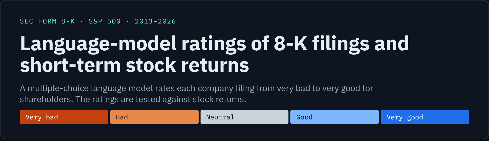
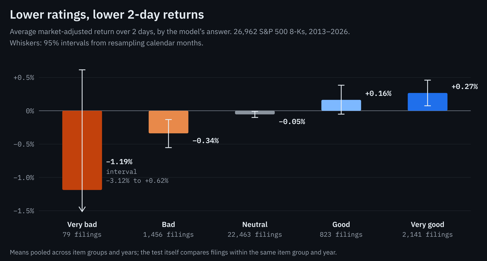
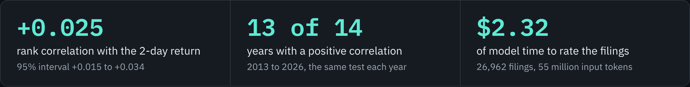
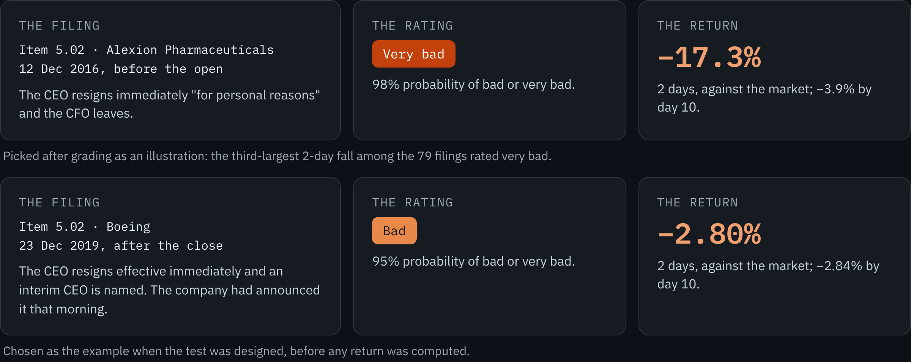

   &nbsp;26,962 filings rated for $2.32 of model time · 417 tests · October 2026 · [magilliam27](https://github.com/magilliam27)

Jev, a decision model from TypeSafe, rated 26,962 8-K filings by S&P 500 companies, filed from January 2013 to October 2026, on a five-point scale from very bad to very good for shareholders. A decision model returns a probability for each answer option and writes no text, so every rating can be ranked.

Filings were compared only with others of the same item group and year. Within those groups, the rating's rank correlation with the next two days' market-adjusted return is +0.025 (95% interval +0.015 to +0.034). Zero would mean no relation, and the correlation is positive in 13 of 14 years. A market-adjusted return is the stock's return minus that of SPY, an S&P 500 index fund, over the same days.

The effect is small and fast. Most 8-Ks (88%) arrive while the market is closed, and most of the move comes before the next morning's open. From that open onward, a follow-up test found nothing reliable left (E12). A faster entry might catch part of the move, such as after-hours or pre-market trading, or trading within minutes of a filing made during the session. Daily prices cannot test that. The main unresolved risk is that the model may have read later news about these events. Re-rating every filing with the company's name hidden left the result unchanged (E13). That adds support to the finding, though it is not conclusive: the model could still recognise most companies from the rest of the text.

**[Full report](docs/REPORT.md)** · [Method](docs/REPORT.md#2-method) · [Results](docs/REPORT.md#3-results) · [Limitations](docs/REPORT.md#4-limitations) · [Costs](docs/REPORT.md#5-costs) · [Reproduce](docs/REPORT.md#appendix-b-reproduction)

## Headline result





For comparison, a free word-tone score scores −0.015 on the same test. It counts positive minus negative words from the Loughran-McDonald finance word list, as a share of all words. Filings with more upbeat wording were followed by slightly worse returns. The model's margin over it is +0.040 (+0.026 to +0.055).

## Two examples



Boeing was named as the example when the test was designed, before any return existed. Alexion was picked afterwards as an illustration. Both are far larger than the average effect.

## What the ratings pick up

| Filings | Average market-adjusted return, 2 days |
| --- | --- |
| Officer changes rated bad (774) | −0.68% (−1.02 to −0.37); −0.89% by day 10 |
| Officer changes rated very bad (25) | −2.16% (−4.26 to −0.17) |
| Deals rated very good (1,941) | +0.32% (+0.12 to +0.53) |
| Deals rated bad (178), against the rating | +0.42% (−0.29 to +1.38) |

The separation is clearest for officer changes. Every item group and rating with at least 20 filings is in [section 3 of the report](docs/REPORT.md#3-results), including the cells that run against the result.

## Limitations

| Limitation | In short |
| --- | --- |
| Model memory | The model may have been trained on later news about these events, and it sees the company name. TypeSafe publishes no training cut-off. With the name hidden the correlation is unchanged (+0.025), which supports the model reading the event rather than the name. It is not conclusive, since the model still picks the right company out of five 72% of the time ([E13](experiments/E13-name-masking/CARD.md)). The 107 filings after the model's release point the same way (+0.034), but are too few to settle it. |
| Speed of the move | For filings made while the market is closed, most of the move comes between the filing and the next open (rank correlation +0.054 for that stretch). From the next open it is +0.006 over 2 days and +0.008 over 5, indistinguishable from zero ([E12](experiments/E12-next-open/CARD.md)). Faster entries were not tested, since only daily prices were used: after-hours, pre-market, or intraday for the 12% of filings made during the session. |
| Small | The rating explains well under 1% of the variation in 2-day returns. It is a tilt across many filings, not a forecast for one. |
| Earlier announcements | Companies often announce the news before the 8-K, so part of the reaction can come before the measured window. |
| AI answer key | The reading check (E10) was graded against three AI reviewers who used the same rubric. |
| Scope | S&P 500 members only. Returns are adjusted for the market only. |

Full detail, related work and the planned follow-up tests are in [section 4 of the report](docs/REPORT.md#4-limitations).

## Controls against bias

| Control | In short |
| --- | --- |
| Design frozen first | Data, question, baseline, measure and pass rule were written down before any rating or return existed. |
| File fingerprints | Every frozen input has a recorded SHA-256 hash. |
| Free baseline | Every test is compared with a free method. |
| Bootstrap intervals | Every headline number carries a 95% interval from resampling (10,000 draws), and a test passes only if its interval excludes zero. |
| Independent replication | A separate session rebuilt E11 from the design and raw data and matched every headline number. |

Detail is in [section 6](docs/REPORT.md#6-controls-against-bias) and [section 7](docs/REPORT.md#7-independent-replication) of the report.

## Quick start

```bash
git clone https://github.com/magilliam27/sec-8k-filings-and-decision-models
cd sec-8k-filings-and-decision-models
pip install -e ".[dev]"
pytest                                   # 417 tests, no network or keys needed
python grading/scripts/check_hashes.py   # checks the published result files against their hashes
python docs/figures/src/make_figures.py  # rebuilds the charts from results/E11-8k-returns/summary.json
```

The per-group correlations behind the headline are in [`results/E11-8k-returns/cells.csv`](results/E11-8k-returns/cells.csv): 44 rows, one per item group and year (auditor changes in two periods, 2013–2017 and 2018–2026). Their filing-weighted average gives +0.025 with no key or price data.

Rating new filings needs a TypeSafe API key (`pip install -e ".[jev]"`), and rebuilding the prices needs an EODHD subscription. See [Appendix B](docs/REPORT.md#appendix-b-reproduction).

## What is in this repository

```text
docs/REPORT.md      the full report: method, results, limitations, costs, controls
src/sec8k/          SEC download, 8-K parsing, name masking, question runner, baselines
scripts/data/       member list, 8-K and price pulls, model scoring
configs/filings/    frozen question files and AI reviewer instructions
experiments/        one card per experiment, E1 to E13, and the ledger
results/            E10 and E11 test sets, baselines, joins, summaries, per-group table
grading/            grading scripts, hash check, verification guide, recheck
recipes/            method write-ups
docs/figures/       README images and the script that rebuilds them
tests/              unit tests
```

Earlier work on 10-K risk factors, which found no return signal, is summarised in [Appendix C](docs/REPORT.md#appendix-c-other-avenues-explored).

## Citation and license

Cite with [`CITATION.cff`](CITATION.cff) (GitHub's "Cite this repository" button). Code is under the [MIT license](LICENSE). Documentation, figures and the files in `results/` and `experiments/` are under [CC BY 4.0](LICENSE-docs.md).
