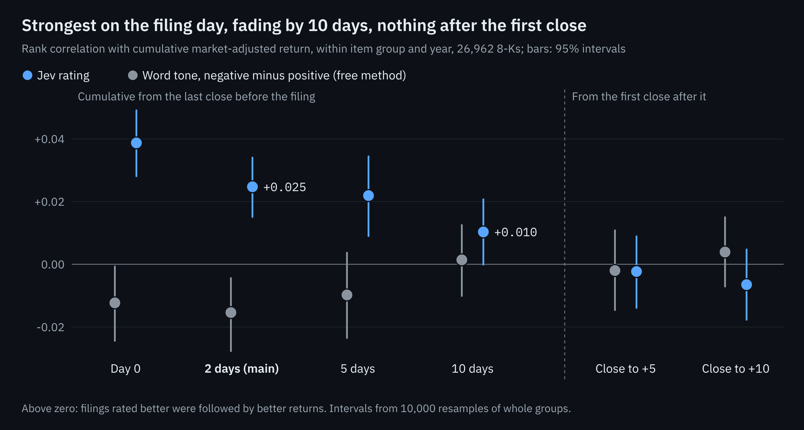

# Decision-model ratings of 8-K filings and short-term stock returns

The full report behind the [repository front page](../README.md). Sections 1 to 7 cover the 8-K study; the appendices hold definitions, reproduction notes and the earlier 10-K work.

**Contents:** [1. Question and approach](#1-question-and-approach) · [2. Method](#2-method) · [3. Results](#3-results) · [4. Limitations](#4-limitations) · [5. Costs](#5-costs) · [6. Controls against bias](#6-controls-against-bias) · [7. Independent replication](#7-independent-replication) · [Appendix A. Definitions](#appendix-a-definitions) · [Appendix B. Reproduction](#appendix-b-reproduction) · [Appendix C. Other avenues explored](#appendix-c-other-avenues-explored)

## 1. Question and approach

The aim is a filing-based signal that can be used on its own or as an input to [MCI-GRU](https://github.com/magilliam27/MCI-GRU), a stock-ranking model.

The ratings come from Jev (jev-1.13.0, from [TypeSafe](https://docs.typesafe.ai)), a decision model: a model that returns a probability for each answer option and writes no text. Each answer therefore converts to a score that can be ranked. The model cannot be fine-tuned, so all design work went into the wording of the question.

**Research question.** When a company files an 8-K reporting an event such as an officer departure, a deal or a restructuring, do lower ratings precede lower returns?

**Reading check.** Before the returns test, the model rated 436 8-Ks from 10 large companies (E10). Its ratings were compared with a key built by three blind AI reviewers. The model ranked the bad events with an AUC of 0.986, against 0.759 for the item code plus word tone. AUC is the probability that a randomly chosen bad filing is ranked above a randomly chosen other one; 0.5 is chance and 1.0 is perfect. The AI reviewers read the same text with the same rubric as the model, so this shows consistent reading, not value. The returns test below needs no key.

**Baselines.** Each result is compared with two simple, free methods:

- **Item code.** The 8-K item number that states the kind of event, such as 5.02 for an officer change. The item codes are combined into four item groups (section 2).
- **Word-tone score.** Positive minus negative words from the Loughran-McDonald finance word list, as a share of all words in the filing. Higher means more upbeat wording. The code stores the opposite sign, negative minus positive, as `net_tone`, and the grading uses minus `net_tone`.

**Related work.** Lopez-Lira and Tang ([2023](https://arxiv.org/abs/2304.07619)) find that GPT-4 ratings of news headlines published after the model's knowledge cut-off capture the initial, non-tradable market reaction, and predict some later drift, mostly in small stocks and on negative news. This study finds the same initial reaction for 8-Ks of large companies, with no drift left from the next open (section 3). Glasserman and Lin ([2023](https://arxiv.org/abs/2309.17322)) separate two biases that arise when a model's training overlaps the test period: look-ahead, where the model knows what followed, and distraction, where general knowledge of the named company interferes with the reading. Their remedy is to remove company identifiers from the text, which was tried here (E13, section 3). Both biases apply (section 4).

## 2. Method

| Step | Detail |
| --- | --- |
| Filings | Every 8-K from January 2013 to October 2026 by an S&P 500 member reporting one of ten event items (officer change, agreement, deal completed, restructuring, impairment, delisting notice, auditor change, restatement, agreement ended, bankruptcy): 28,253. |
| Exclusions | Set before any score existed: 848 filings that also reported earnings, 253 same-day duplicates, and 190 without prices or a full 10-day window. 26,962 remain. |
| Model input | The filing text plus facts known on the filing date: the company name, item codes, prior-year revenue and the company's 8-Ks from the previous 90 days. One question with a fixed rubric. |
| Return | Market-adjusted: the stock's return minus that of SPY, an S&P 500 index fund. It starts at the last close before the SEC accepted the filing, so no price move before publication is counted. Day 0 is the first trading day whose close comes after acceptance; its close is the **first close** after the filing. |
| Comparison | Within the same item group (officer change, deal, negative-leaning, auditor change) and year, 44 groups in all, so the item code alone cannot explain the result. |
| Measure | Rank correlation (Spearman): how far two orderings agree, from −1 to +1, where zero means no relation. It is computed within each group and averaged, weighted by filings. |
| Intervals | 10,000 bootstrap resamples of those groups (Appendix A). |

## 3. Results

**Main result.** Within item group and year, the rating's rank correlation with the 2-day market-adjusted return is **+0.025 (95% interval +0.015 to +0.034)**. The design's pass rule was an interval clear of zero. The word-tone score gives −0.015 (−0.028 to −0.004): filings with more upbeat wording did slightly worse. The model's margin over it is +0.040 (+0.026 to +0.055). The 44 group-level correlations are in [`results/E11-8k-returns/cells.csv`](../results/E11-8k-returns/cells.csv).

The association is strongest on the filing day and fades by day 10. Measured from the first close after the filing, neither method predicts returns.

**From the next open (E12).** Most 8-Ks (88%) arrive while the market is closed. A follow-up test measured returns from the first regular-session open after each filing. From there the correlation is +0.006 (−0.005 to +0.017) over 2 trading sessions and +0.008 (−0.006 to +0.022) over 5, so nothing reliable remains from the open. For filings made while the market is closed, most of the move happens between the close before the filing and the next open (+0.054 for that stretch alone), the hours when only after-hours and pre-market trading is possible. One pattern, found by looking rather than tested on its own: officer changes rated bad kept sliding after the open, −0.33% (−0.60 to −0.08) over 2 sessions (706 filings). The design was frozen before any opening price was read; see the [E12 card](../experiments/E12-next-open/CARD.md).

**With the company name hidden (E13).** The main risk to the result is that the model remembers how these events ended (section 4). A follow-up test re-rated all 26,962 filings twice with the filer's identity hidden, as Glasserman and Lin do. The **name mask** replaced the company's names, tickers and web addresses; the **deep mask** also replaced named people, other organisations, places and products. The question was unchanged, and the design was frozen before any masked rating existed.

| Rating | 2-day correlation | Change against the name shown |
| --- | --- | --- |
| Name shown (E11) | +0.025 (+0.015 to +0.034) | |
| Name mask | +0.025 (+0.014 to +0.036) | +0.001 (−0.003 to +0.005) |
| Deep mask | +0.024 (+0.014 to +0.034) | −0.001 (−0.006 to +0.005) |

Masking changed the model's answer on about 2% of filings, against 0.5% when the same unmasked question is simply asked again. But the masks did not stop the model from recognising the company. Asked to pick the filer from five companies in the same industry, it chose correctly 72% of the time under the name mask and 64% under the deep mask, against 20% by chance. Most of that comes from press releases attached to the 8-K, which end with an "About the company" paragraph. Under the rule set in advance, the verdict is therefore **unclear**: the signal survives masking, but masking did not hide the company.

A reading added after the result, at the owner's suggestion: if the signal came from the model recalling each company's story, it should have fallen roughly in proportion to the filers the model could no longer identify. It did not.

| Mask | Filers no longer identified | Expected change if memory drove the signal | Observed change (95% interval) |
| --- | --- | --- | --- |
| Name mask | 35% | about −0.009 | +0.001 (−0.003 to +0.005) |
| Deep mask | 45% | about −0.011 | −0.001 (−0.006 to +0.005) |
| Deep mask, filings without a press release (17,101) | 63% | about −0.017 | −0.001 (−0.009 to +0.008) |

The leak check is a pick among five, so 20% would be right by guessing; the share still identified is therefore (accuracy − 20%) ÷ 80%, and the rest counts as lost. The expected change is the share lost times the same filings' correlation with the name shown: +0.025 overall and +0.027 for the filings without a press release. These figures were computed after grading and are in [`posthoc.json`](../experiments/E13-name-masking/grading/posthoc.json).

A proportional drop lies outside the observed interval in all three rows. The argument has a weakness: memory need not be spread evenly. It may sit mostly in famous events, which the model still recognises under both masks. So this is not a perfect result, but it adds support to the main finding that the model reads the event rather than the name. The forward hold-out (section 4) remains the clean test. Detail, including results by period and company size, is on the [E13 card](../experiments/E13-name-masking/CARD.md).

**By year.** The correlation is positive in 13 of 14 years. It is weaker in recent years: the average of the yearly values is +0.036 for 2013 to 2017 and +0.010 for 2022 to 2026 (`by_year` in [`summary.json`](../results/E11-8k-returns/summary.json)). This decline is what look-ahead would produce, since older events have had more coverage. It is also what a market that prices 8-Ks faster would produce. The data cannot separate the two.

Positive ratings show a smaller effect (see the [headline chart](../README.md#headline-result)): only "very good" is clearly above zero. 83% of filings are rated neutral, and their returns are close to zero.

**Returns by item group and rating.** Every cell with at least 20 filings, including cells that run against the overall result. Average market-adjusted return with 95% intervals from 2,000 resamples of whole calendar months.

| Item group | Model's answer | Filings | 2 days | 10 days |
| --- | --- | --- | --- | --- |
| Officer change | very bad | 25 | −2.16% (−4.26 to −0.17) | −2.45% (−5.61 to +0.40) |
| Officer change | bad | 774 | −0.68% (−1.02 to −0.37) | −0.89% (−1.40 to −0.36) |
| Officer change | neutral | 15,348 | −0.06% (−0.11 to −0.00) | −0.13% (−0.27 to +0.01) |
| Officer change | good | 53 | +0.27% (−0.42 to +0.98) | −0.64% (−2.24 to +0.81) |
| Officer change | very good | 63 | +0.14% (−0.56 to +0.82) | −0.11% (−1.56 to +1.11) |
| Deal | bad | 178 | +0.42% (−0.29 to +1.38) | +0.23% (−1.11 to +1.93) |
| Deal | neutral | 6,112 | −0.06% (−0.13 to +0.01) | −0.13% (−0.35 to +0.10) |
| Deal | good | 714 | +0.14% (−0.09 to +0.37) | +0.07% (−0.45 to +0.60) |
| Deal | very good | 1,941 | +0.32% (+0.12 to +0.53) | +0.11% (−0.24 to +0.46) |
| Negative-leaning | very bad | 44 | −0.87% (−2.81 to +0.75) | −0.98% (−4.06 to +2.01) |
| Negative-leaning | bad | 501 | −0.07% (−0.34 to +0.20) | +0.22% (−0.33 to +0.81) |
| Negative-leaning | neutral | 942 | −0.02% (−0.22 to +0.17) | −0.23% (−0.62 to +0.16) |
| Negative-leaning | good | 56 | +0.40% (−0.49 to +1.26) | +1.70% (+0.04 to +3.58) |
| Negative-leaning | very good | 135 | −0.49% (−1.48 to +0.18) | −0.35% (−1.56 to +0.62) |
| Auditor change | neutral | 61 | +0.29% (−0.35 to +0.98) | +0.99% (−0.34 to +2.52) |

Separation is clearest for officer changes. For deals and negative-leaning items, the bad and very good cells are mixed. The item code alone has no predictive value (−0.005, interval −0.017 to +0.006). Per-item results and day-by-day paths are in [`summary.json`](../results/E11-8k-returns/summary.json).

**Economic size.** Within each item group, the top fifth of filings by rating outperformed the bottom fifth by 0.29 percentage points over two days (+0.16 to +0.42), before trading costs. Most of this move comes before the next open, so it is not a return available from that open. Whether a faster entry captures part of it was not tested.

## 4. Limitations

The result is consistent across filings and years, but it is small and short-lived, and it rests on an assumption that could only be partly tested: that the model had no knowledge of how these events unfolded.

| Limitation | Detail |
| --- | --- |
| Model memory (principal risk) | The model may have been trained on later reporting about these events. TypeSafe does not publish a training cut-off, so the planned check on filings after the cut-off could not be run. The model also sees the company name, the most likely route for it to recall how a story ended. With the name hidden the result was unchanged, but the model could still identify most companies from the remaining text (E13, section 3), so this risk is reduced rather than removed. The 107 filings dated after the model's release on 10 September 2026 show the same direction (+0.034), but are too few to be conclusive. The weaker recent years (section 3) are consistent with memorisation but do not prove it. |
| Next test for memory | The name-masking test has been run (E13). The remaining test is a forward hold-out: filings arriving after the model's cut-off are rated, and their ratings are hashed and published before their returns exist. A stronger mask that also drops the press release's "About the company" paragraph would be a further check. |
| Small per filing | The rating explains well under 1% of the variation in 2-day returns. It is a tilt across many filings, not a forecast for any one. |
| Timing | Most of the move comes before the next open. From that open onward nothing reliable remains (E12, section 3). Two faster entries were not tested, since only daily prices were used: before the open, in after-hours or pre-market trading, where volume is thinner and spreads wider; and within minutes of a filing made during the session. They are the natural next test for a trading use. |
| Earlier announcements | Many companies issue a press release before the 8-K, so the window can miss the first reaction. Filings with a press release attached, more likely to be the first announcement, show a stronger association: +0.042 against +0.027. |
| Baseline not combined | The model was compared with the word-tone score directly. Its value in addition to word tone was not tested. |
| AI answer key (E10) | The reading check was graded against three blind AI reviewers who used the same rubric as the model, so it shows consistent reading rather than value. The returns test needs no key. |
| Scope | S&P 500 members only. Returns are adjusted for the market only, with no industry, size or value controls. Prices are EODHD adjusted closes, with no delisting payouts. |

## 5. Costs

Rating the 26,962 filings took 55.2 million input tokens of model time. At TypeSafe's published price for jev-1.13.0 of $0.042 per million input tokens ([docs.typesafe.ai/models](https://docs.typesafe.ai/models), read 18 October 2026), that is $2.32, or about 9 cents per 1,000 filings.

| Item | Model time |
| --- | --- |
| Returns test (E11) | $2.32 for 26,962 filings (55.2 million input tokens) |
| Reading check (E10) | About $0.07 for 436 filings (1.7 million input tokens) |
| Next-open test (E12) | None; it reuses the E11 ratings |
| Name-masking test (E13) | About $4.89: the 26,962 filings rated under two masks (108.7 million input tokens) and the company-identification check (7.8 million) |
| Ongoing rating | About 1,950 qualifying 8-Ks a year, or about 18 cents a year |

These figures cover model time only. They exclude the price data (a paid EODHD subscription) and the AI coding and review sessions used to build and check the work, neither of which was metered per task. SEC filings are free to download.

## 6. Controls against bias

| Control | Detail |
| --- | --- |
| Pre-registration | Each experiment's design (data, question, baseline, measure and pass rule) was fixed before any labels, model answers or prices existed. Any change to the question, data or key required a new experiment id. For E11 the design was frozen on 16 October at 12:45 UTC, the filings published at 14:24, the ratings produced at 03:17 the next day, and returns computed only after that. |
| File fingerprints | The SHA-256 hash of every frozen file is recorded at the time of freezing, so graded files can be matched to frozen ones (Appendix B). |
| Baseline comparison | Every test compares the model with a free method, and a pass requires the 95% interval of the difference to exclude zero. |
| Bootstrap intervals | Correlations are resampled by item-group-and-year cell (10,000 draws) and average returns by calendar month (2,000 draws), so one busy group or month cannot drive the result. A test passes only if its 95% interval excludes zero. |
| Shuffle test | In the replication, shuffling the ratings within groups 200 times gave correlations centred near zero; the observed +0.025 exceeded every shuffle. |
| Recomputation | Every verdict number was recomputed by script, at least one case was traced by hand, and E11 was replicated independently. |

## 7. Independent replication

A separate AI session received the frozen design and the raw data, but not the grading code, and rebuilt E11 from scratch. It reproduced every headline number.

| Figure | Reported | Recomputed |
| --- | --- | --- |
| Events (officer, deals, negative, auditor) | 26,962 (16,263, 8,953, 1,678, 68) | identical |
| Model, 2-day correlation | +0.025 (+0.015 to +0.034) | +0.0247 (+0.0151 to +0.0340) |
| Model minus word-tone score, 2-day | +0.040 (+0.026 to +0.055) | +0.0401 (+0.0260 to +0.0545) |
| Model, 10-day correlation | +0.010 (−0.000 to +0.021) | +0.0103 (−0.0001 to +0.0207) |
| Officer changes rated bad, mean 2-day return | −0.684% | −0.684% |

Further checks:

| Check | Result |
| --- | --- |
| Returns | All 1-, 2- and 10-day returns match event by event. Three were traced by hand: Stericycle (very bad, −15.7% against the market), Andeavor (very good, +2.9%) and Tapestry (neutral, +0.7%). |
| Permutation test | Shuffling the ratings within groups 200 times gives correlations centred near zero. The observed +0.025 exceeds every shuffle. |
| Look-ahead | In 26,961 of 26,962 filings the starting price precedes publication. The exception was accepted at exactly 16:00:00, the moment of the close. |
| Ticker matching | For 166 filings with an ambiguous ticker (FOX/FOXA, GOOG/GOOGL and similar), the replication used the original symbol, which was always one of its own two candidates. |
| Error found | The 10-day column of the item-group table covered one extra trading day. It has been corrected; no correlation or verdict changed. 30 stocks that stopped trading right after a filing now earn the market return, as designed. |
| Minor notes | About 21 filings fell on half-day sessions, with no look-ahead. Auditor changes (68 filings) run the other way (−0.09) but carry 0.3% of the weight. |

## Appendix A. Definitions

| Term | Meaning |
| --- | --- |
| 10-K | The annual report. Its "risk factors" section lists what could harm the business. |
| 8-K | A report of a single event, filed within four business days. |
| Item code | The 8-K item number that states the kind of event (5.02 is an officer change, 1.01 a material agreement). |
| Item group | One of four groups of item codes used for comparison: officer change, deal, negative-leaning and auditor change. |
| Decision model | A model that returns a probability for each answer option and writes no text. |
| Market-adjusted return | The stock's return minus the return of SPY, an S&P 500 index fund, over the same days. |
| First close | The first closing price after the SEC accepted the filing. |
| Rank correlation (Spearman) | Agreement between two orderings, from −1 to +1; zero means no relation. |
| AUC | The probability that a randomly chosen true case is ranked above a randomly chosen non-case; 0.5 is chance, 1.0 perfect. |
| 95% interval | The range likely to contain the true value, computed by bootstrap: the data are resampled with replacement thousands of times and the middle 95% of the recomputed values is kept. A test passes only if the interval excludes zero. |
| Word-tone score | Positive minus negative words from the Loughran-McDonald finance word list, as a share of all words in the filing. Higher means more upbeat wording. |
| E1 to E13 | Experiment ids, in order of design. |

## Appendix B. Reproduction

The original research folder held the bulk data (filings, prices) and the model's stored answers. In that folder, E11 and E10 reproduce their published `summary.json` byte for byte with no new model calls, and the independent replication matched every headline number.

This repository publishes the code, the frozen questions, the experiment records and the summary results. Three checks need no key and no price data:

- `python grading/scripts/check_hashes.py` matches the published result files against their recorded hashes.
- [`results/E11-8k-returns/cells.csv`](../results/E11-8k-returns/cells.csv) lists, for each of the 44 item-group-and-year cells (auditor changes pooled into 2013–2017 and 2018–2026), the filings and the model's and the word-tone score's rank correlations at 2 and 10 days. The filing-weighted averages reproduce the headline (+0.025, −0.015; +0.010, +0.001).
- `python docs/figures/src/make_figures.py` rebuilds every chart from `summary.json` (`node docs/figures/src/render.mjs` renders them to PNG).

The repository does not include:

| Not included | Reason | How to obtain it |
|---|---|---|
| SEC filings | Large, and free to download | `scripts/data/build_sp500_members.py` and `scripts/data/export_sec_member_8k.py` rebuild the 28,253-filing set from EDGAR |
| Daily prices | Paid EODHD data | An EODHD subscription and `scripts/data/pull_eodhd_prices.py` |
| The model's per-filing ratings | Not published | Re-ask the model with `scripts/data/score_8k_events.py` (about $2.32 for all filings) |
| Loughran-McDonald word list | Free for academic use only | Download from the Software Repository for Accounting and Finance at the University of Notre Dame |

Repeated calls to the model give slightly different probabilities, so re-asked ratings will be close to the originals but not identical. With those inputs in place, [`grading/VERIFY.md`](../grading/VERIFY.md) documents every grading script and command. The replication code is `grading/independent_recheck/independent_recheck_code.py`. Software used: Python 3.13, pandas 3.0, numpy 2.5.

The work was done in the MCI-GRU repository, where the frozen inputs were fixed at these commits: the question file `questions_v5.yaml` at [3a1be7f](https://github.com/magilliam27/MCI-GRU/commit/3a1be7f), the 8-K dataset code at [e502416](https://github.com/magilliam27/MCI-GRU/commit/e502416), and the baseline and scoring code at [631301f](https://github.com/magilliam27/MCI-GRU/commit/631301f). The E13 masking code was fixed at [44f708d](https://github.com/magilliam27/MCI-GRU/commit/44f708d).

SHA-256 fingerprints of the E11 inputs, recorded when each was frozen:

| File | Frozen | SHA-256 starts … ends |
| --- | --- | --- |
| 8-K events, `member_8k_events.jsonl` | 16 Oct 14:24 UTC | 04172c9b … 931f |
| Test-set ids, `events.csv` | 16 Oct 14:26 UTC | f885c806 … 0b3b |
| Word-tone baseline, `baselines.csv` | 16 Oct 14:29 UTC, before any model call | 9a6296a9 … 1bdda |
| The model's ratings, `scores.csv` | 17 Oct 03:17 UTC, before any return | eb56f1c8 … d05b |
| The model's raw answers, `rating.jsonl` | 17 Oct 03:17 UTC | 8b3456b9 … 3bfc |

`events.csv` and `baselines.csv` are in `results/E11-8k-returns/` and can be checked against these fingerprints.

**Corrections.** The 10-day column of the E11 item-group table was corrected after the replication; the original output is kept as `results/E11-8k-returns/summary_v1.json`.

## Appendix C. Other avenues explored

Before the 8-K study, the programme examined 10-K risk factors, the annual list of what could harm a business. Each step followed from the result of the one before.

| Step | Question | Result |
| --- | --- | --- |
| 1 | Can the model detect that a 10-K risk changed from the prior year? | No better than a word count across five tests on 11 companies (E1 to E6). Stopped. |
| 2 | Can it judge whether a change made a risk worse or better? | Yes, on two separate sets of 10 companies (E8, E9). Word counts cannot judge direction. |
| 3 | Do 10-K risk changes predict 1 to 6 month returns? | No, for either the model or word counts (E7, 6,871 S&P 500 10-Ks). |
| 4 | Move to 8-Ks, which report new events | Reading check passed (E10), followed by the returns test (E11), the next-open test (E12) and the name-masking test (E13). |

A likely reason for the 10-K null result is that S&P 500 stocks are closely followed and risk sections change slowly. E7 does not rule out the published "Lazy Prices" effect (Cohen, Malloy and Nguyen, 2020) in smaller stocks or earlier periods.

Of the twelve experiments run, four passed (three on reading, one on returns), seven did not beat a free method or failed, and one, the memory check (E13), was unclear. One was withdrawn before any work.

| Id | Question | Data | Model | Baseline | Verdict |
| --- | --- | --- | --- | --- | --- |
| E13 | Does the 8-K rating survive with the company name hidden? | 26,962 8-Ks from E11, masked | +0.025 (2-day correlation, name masked) | +0.025 (same rating, name shown) | Unclear: change +0.001 (−0.003 to +0.005), but the model still identified 72% of filers |
| E12 | Does the 8-K rating predict returns from the next open? | 23,585 closed-market 8-Ks from E11 | +0.006 (2-session correlation) | −0.019 (word-tone score) | Fail: model interval −0.005 to +0.017 |
| E11 | Does the 8-K rating predict the next days' return? | 26,962 S&P 500 8-Ks | +0.025 (2-day correlation) | −0.015 (word-tone score) | Pass: +0.040 (+0.026 to +0.055) |
| E10 | How good or bad is an 8-K event? | 436 8-Ks, 10 companies | 0.986 (AUC for bad events) | 0.759 (item code + word tone) | Pass: +0.227 (+0.128 to +0.323) |
| E9 | Did a changed risk get worse? (repeat of E8) | 167 changed risks, 10 new companies | 0.947 | 0.838 (text-growth score) | Pass: +0.109 (+0.024 to +0.199) |
| E8 | Did a changed risk get worse, better or neither? | 300 risks, 10 companies | 0.979 | 0.926 (text-growth score) | Pass: +0.053 (+0.003 to +0.132) |
| E7 | Do 10-K risk changes predict 1 to 6 month returns? | 6,871 S&P 500 10-Ks | −0.016 (worse share beyond changed share, 3 months) | +0.004 (Lazy Prices section change) | Fail: neither excludes zero |
| E6 | Did this risk materially change? | 183 Alphabet risks | 0.917 | 0.884 | Stopped: −0.02 to +0.09 |
| E5 | Which risks are new or changed? | 300 risks, 10 companies | 0.987 new, 0.946 changed | 0.999 new, 0.962 changed | Stopped: baseline equal or better |
| E4 | Did this risk change? | 100 Alphabet risks | 0.906 | 0.887 | Stopped: −0.06 to +0.10 |
| E3 | E2 with a new answer key | — | — | — | Withdrawn |
| E2 | How did this risk change? (5 options) | 76 Alphabet risks | 81% | 67% (word rule) | Inconclusive: −7 to +25 points |
| E1 | Is last year's risk the same risk? | 200 Alphabet pairs, hand-labelled | 92.5% | 94.5% (best word match) | Worse: −5.1 points (−9.5 to −1.3) |

Scores are AUC except accuracy for E1 and E2 and correlations for E7, E11, E12 and E13. Verdict intervals refer to the model's margin over the baseline, except E12, whose pass rule was on the model alone, and E13, whose baseline is the same rating with the name shown. Answer keys for the reading tests came from three blind AI reviewers rather than people. On E2 a manual spot check agreed with them on 11 of 20 items, short of the 15 set in advance; the AI key was retained, a decision made before any model answer existed. E7, E11, E12 and E13 need no key, since the stock price is the outcome.

The design and result of every experiment are in [`experiments/`](../experiments/), with a running log in [`experiments/LEDGER.md`](../experiments/LEDGER.md). Practical write-ups of each method are in [`recipes/`](../recipes/).
